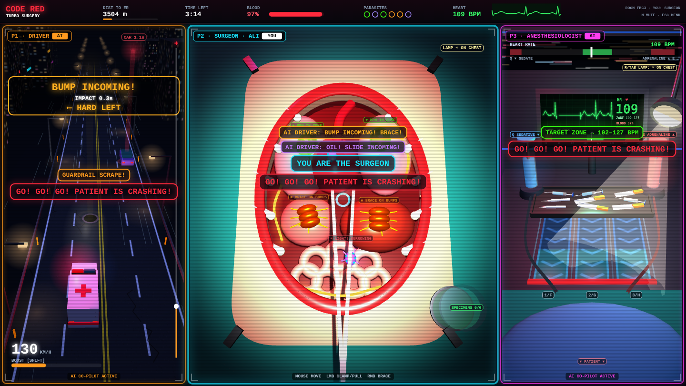
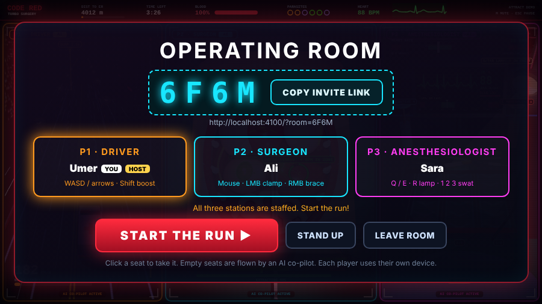

# 🚑 CODE RED: TURBO SURGERY

**Online 3-player co-op. Three people, three devices, one speeding ambulance, six glowing alien parasites. Don't let the patient flatline.**

Built with **Three.js** (three live 3D views in one WebGL renderer), **Socket.IO** rooms, and the **Web Audio API** (every sound is synthesized, no audio files).



## How online play works

1. One player opens the site and clicks **CREATE ROOM**. They get a 4-letter code and an invite link.
2. They send the link to two friends. Each opens it **on their own device**, types a name, and clicks **JOIN ROOM**.
3. Each player takes a seat: **Driver**, **Surgeon** or **Anesthesiologist**. Seats fill automatically as people join, and you can click a seat to switch.
4. The host clicks **START THE RUN**. Every player sees all three stations, with their own station enlarged, but **controls only their own**.

Any seat left empty is flown by an AI co-pilot, so you can also play with 1 or 2 people. If someone drops mid-run, the AI takes over their station. If the host leaves, host passes to another player.



The server runs the game simulation for every room (60 Hz) and streams it to the players (20 Hz), so everyone sees the same patient.

## The three stations

| Station | Controls | Job |
|---|---|---|
| **P1 · Driver** | `W` `A` `S` `D` / arrows, `Shift` boost | Dodge potholes, oil slicks, traffic. Warning beacons show hazards ~2s out. Shout callouts! |
| **P2 · Surgeon** | Mouse, hold `LMB` clamp/pull, hold `RMB` brace | Pull 6 parasites out of the open chest. Keep tension in the green band. Avoid nerves and ribs. |
| **P3 · Anesthesiologist** | `Q` sedate, `E` adrenaline, `R`/`Tab` lamp, `1` `2` `3` or `F` `G` `H` swat | Hold BPM in the shifting zone, swing the surgical lamp, and swat flying tools when their lane turns green. |

Every bump the driver hits jolts the surgeon's forceps **and** launches scalpels, syringes and bone saws off the anesthesiologist's tray toward the patient.

**Parasites:** Photophobic (violet: lamp OFF to pull) · Pulse-Linked (green: only while BPM is in the zone) · Armored Tick (amber: long pull, brace on every bump).

**Win:** reach the hospital with all 6 parasites out. **Lose:** blood hits 0% or the 3:30 clock runs out.

Also included: **Local co-op** (3 players on one keyboard + mouse) and **Solo test mode** (play any station, AI flies the rest).

## Run it locally

```bash
npm install
npm start            # http://localhost:3000
```

Open the address in three browser windows to try a room by yourself.

```bash
npm test             # simulation + 3-client server tests
```

## Deploy on Render

This repo includes `render.yaml`. In Render: **New → Blueprint →** pick this repo **→ Apply**. It creates one free web service (Node 20, Singapore region) that serves the page and the WebSocket backend on the same URL.

Manual alternative: **New → Web Service →** this repo, Runtime **Node**, Build `npm ci --omit=dev`, Start `npm start`, Health check `/health`.

Free Render services sleep after ~15 minutes without visitors, so the first visit after that can take up to a minute to wake the server.

## Project structure

```
server/index.js        Express + Socket.IO: rooms, seats, server-run simulation loop
public/index.html      page, menus, lobby
public/js/sim.js       shared game rules (runs on the server AND in the browser for local play)
public/js/client.js    rendering (3 scissored Three.js views), HUD, audio, input, networking
public/vendor/         Three.js r128 (bundled)
test/                  node tests
render.yaml            Render Blueprint
Dockerfile             optional container build
```

## License

MIT. Three.js is © three.js authors, MIT licensed.
